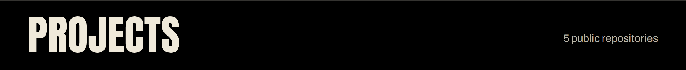
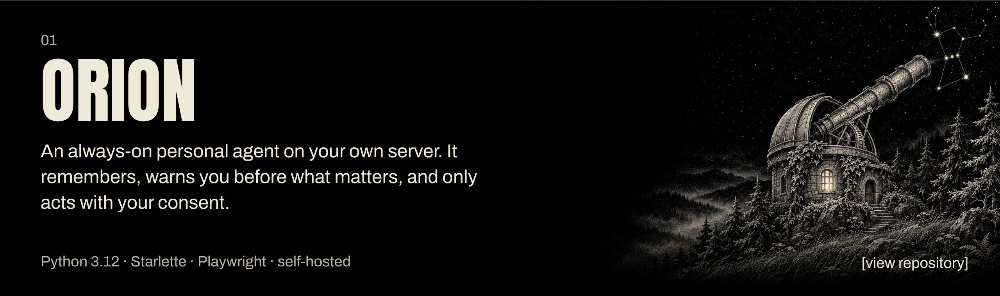
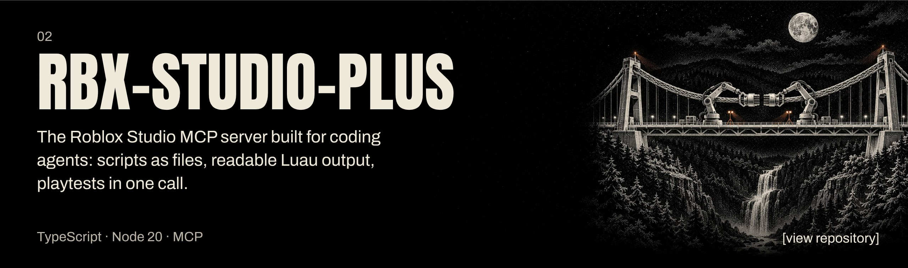
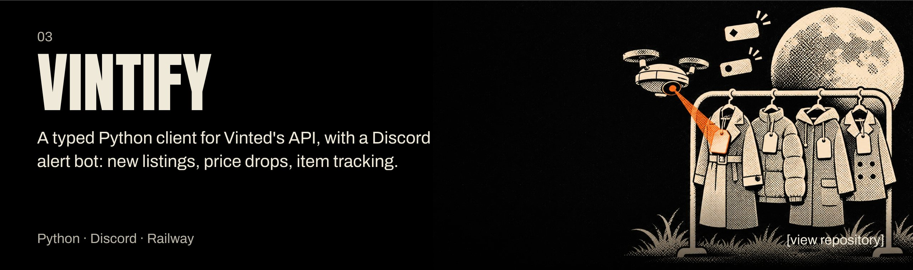
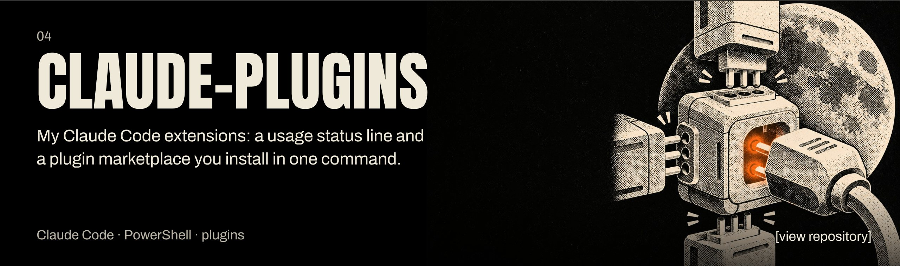
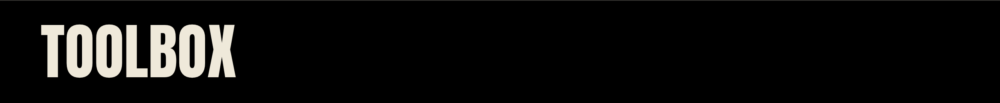
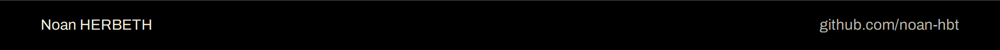

| | |
|---|---|
| **Languages** | `Python` `TypeScript` `Luau` `PowerShell` |
| **Agents** | `MCP` `Claude Code` `Playwright` |
| **Backend** | `Starlette` `httpx` `Pydantic` |
| **Deployment** | `Linux` `Docker` `Railway` |

