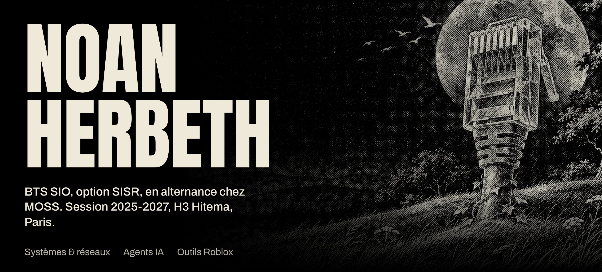
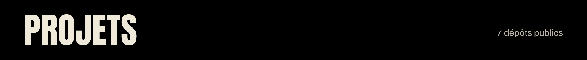
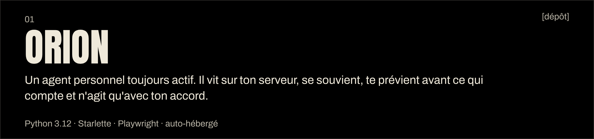
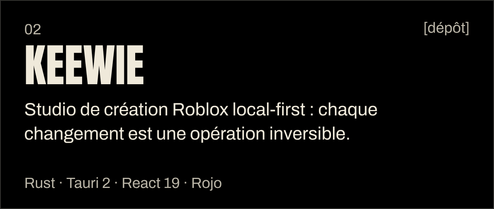
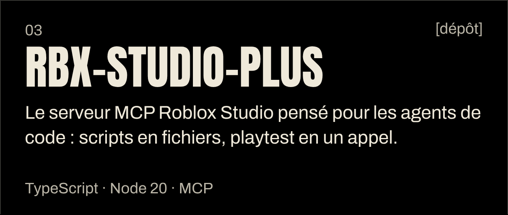
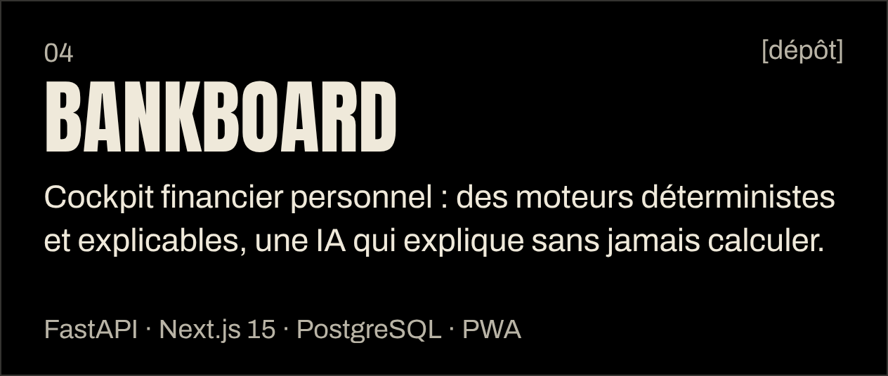
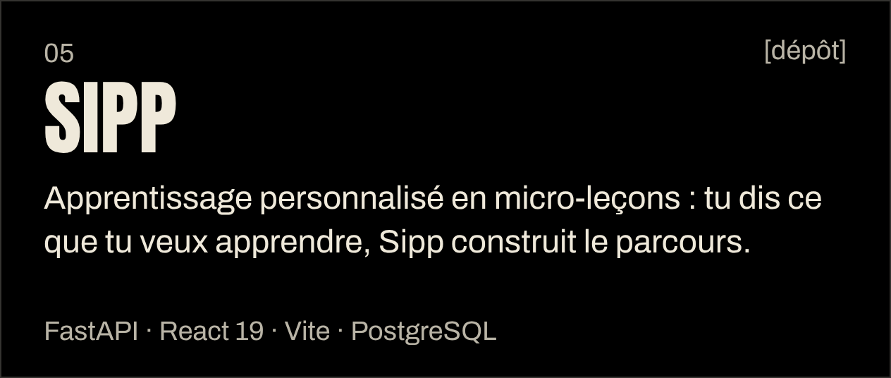
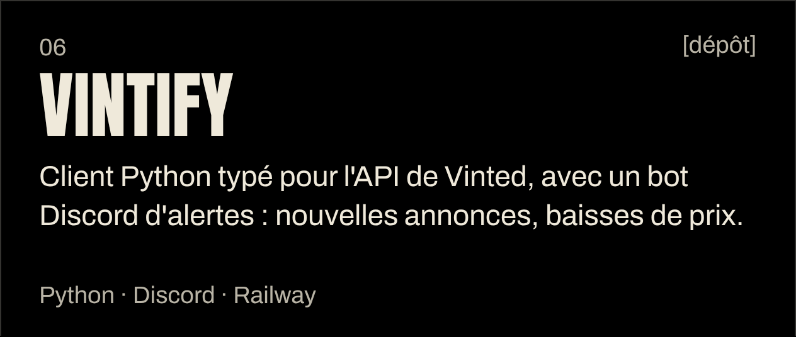
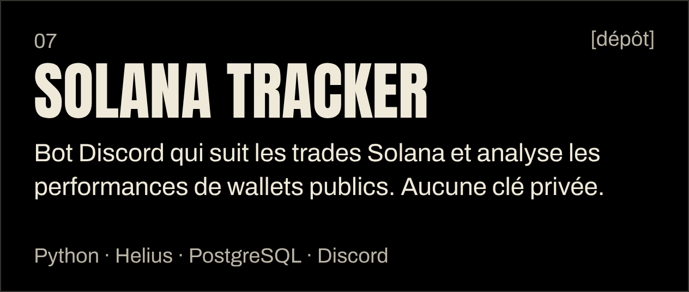
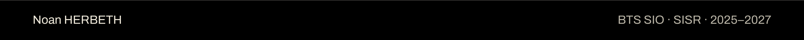

  <a href="https://noanherbeth.fr">[site]</a>&nbsp;&nbsp;
  <a href="https://noanherbeth.fr/presentation">[présentation]</a>&nbsp;&nbsp;
  <a href="https://noanherbeth.fr/competences">[compétences]</a>&nbsp;&nbsp;
  <a href="https://noanherbeth.fr/realisations">[réalisations]</a>&nbsp;&nbsp;
  <a href="https://noanherbeth.fr/alternance">[alternance]</a>&nbsp;&nbsp;
  <a href="https://noanherbeth.fr/veille">[veille]</a>

Étudiant en BTS SIO option SISR à H3 Hitema (Paris), en alternance chez MOSS. Le jour, des systèmes et des réseaux. Le reste du temps, je construis des agents IA, des outils pour Roblox Studio et des applications que j'utilise vraiment.

| | |
|---|---|
| **Langages** | `Python` `TypeScript` `Rust` `Luau` `SQL` |
| **Back** | `FastAPI` `Starlette` `SQLAlchemy` `PostgreSQL` |
| **Front** | `React` `Next.js` `Vite` `Tauri` |
| **Agents** | `MCP` `Playwright` `Discord` |
| **Déploiement** | `Docker` `Railway` `Linux` |

  <a href="https://noanherbeth.fr">[noanherbeth.fr]</a>&nbsp;&nbsp;
  <a href="https://github.com/noan-hbt?tab=repositories">[tous les dépôts]</a>

